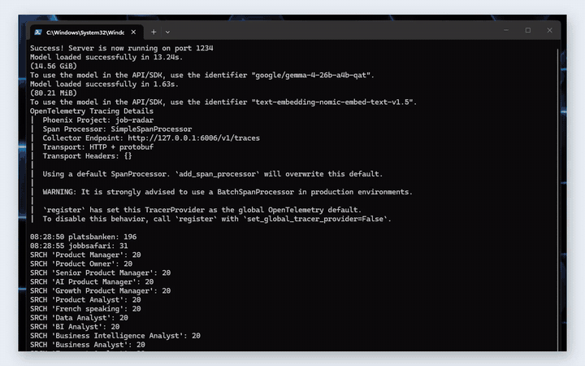
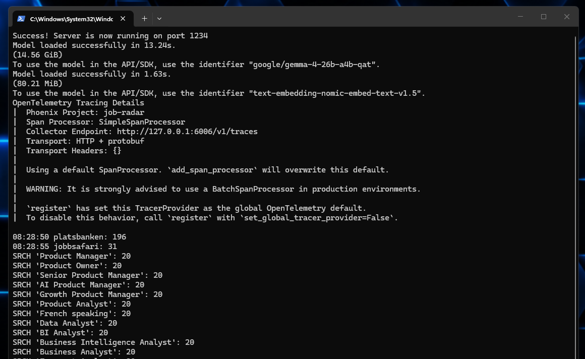
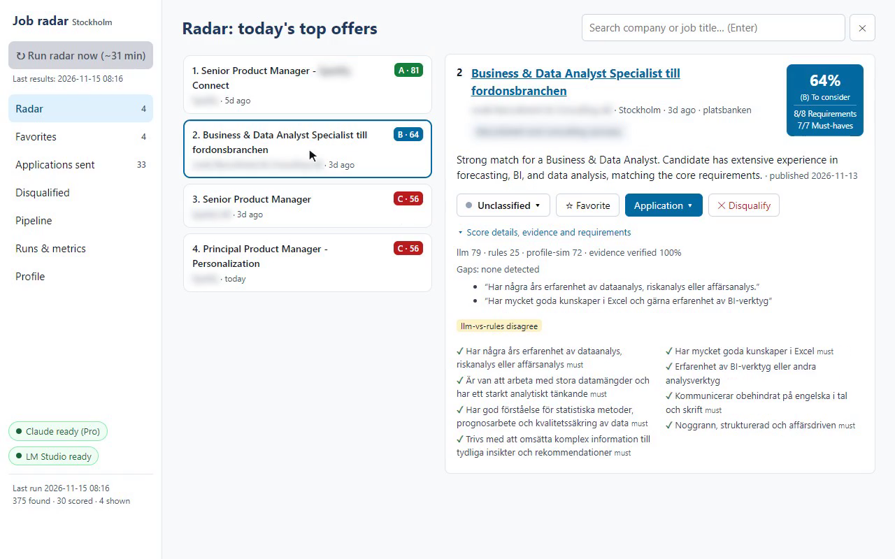
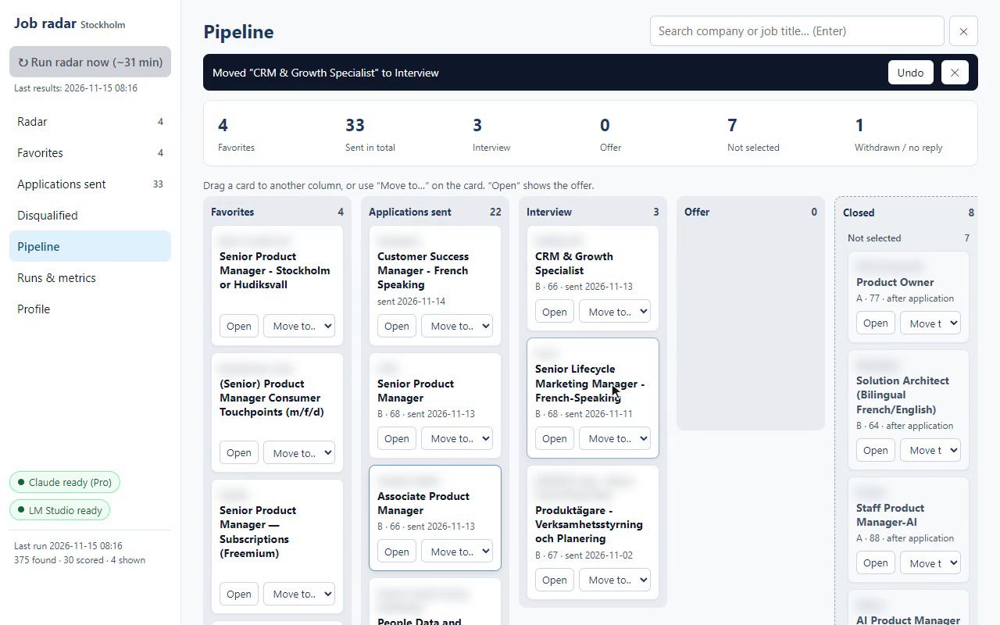
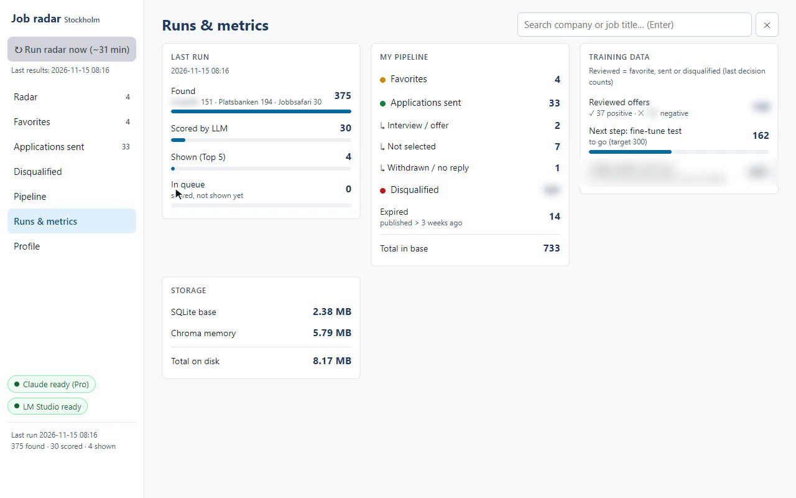
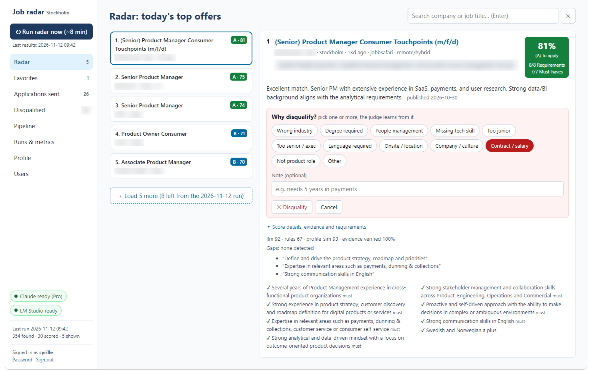
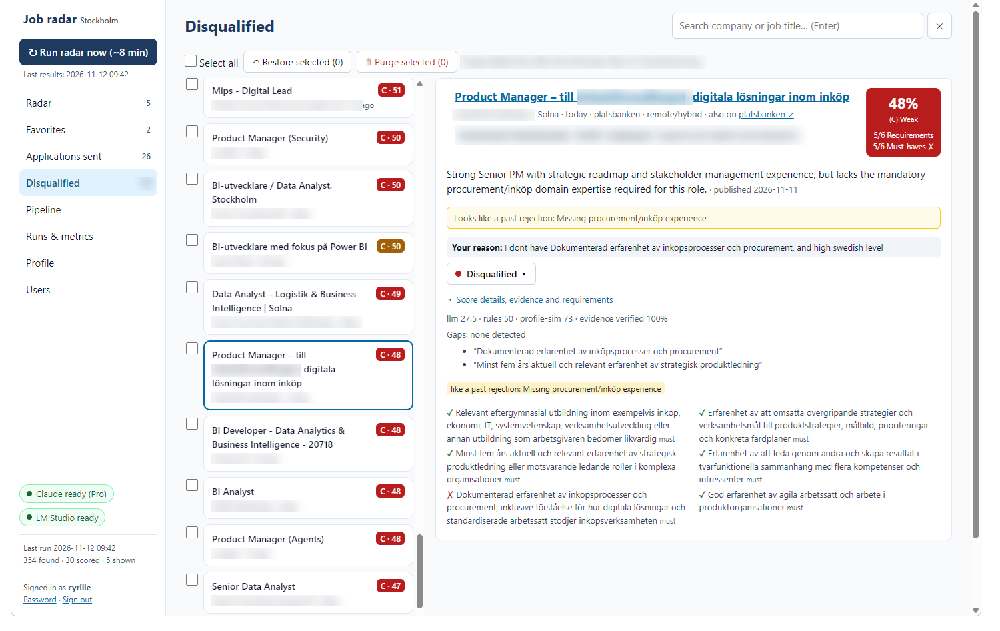

# Job Radar

**Case study (closed source).** This repository holds screenshots, a demo and the story behind the project. It contains no code.

Every morning Job Radar reads about 350 fresh job offers around Stockholm and gives me a top 5, scored 0 to 100 against my profile. Each score comes with quotes from the posting as evidence. It runs on my own PC, uses a local LLM, and is read-only. It never applies to anything or sends anything.



Full write-up: [cyrille-pillon.com/job-radar](https://cyrille-pillon.com/job-radar)

## Why I built it

Searching by keyword found plenty, but not the right things. "Product Manager" in Stockholm returns hundreds of ads a week, and most of them fail on one hard requirement buried in paragraph four: a degree, ten years in payments, native Swedish. Reading them all took an hour a day. I wanted the machine to do the first read the way I would, and to show its reasoning so I could check it in seconds.

## How it works

```
collect -> filter -> rules -> embed -> judge -> verify -> rank -> report
```

1. **Collect.** Public job boards, Platsbanken (the Swedish employment service) and Jobbsafari among them. About 350 offers a day.
2. **Filter.** Drops expired ads, offers I already decided on, and duplicates of the same job posted on two boards.
3. **Rules.** Cheap checks for hard gaps, such as a required degree or a language I don't speak.
4. **Embed.** Compares each offer with my profile text in a vector store.
5. **Judge.** A local LLM checks the shortlist (about 30 offers) requirement by requirement and returns structured JSON.
6. **Verify.** Every quote the judge cites must exist in the posting. Unverified claims are flagged.
7. **Rank and report.** The score blends the judge, the rules and the profile match. Classes A (apply), B (consider) and C (weak).

A typical run takes 7 to 11 minutes, almost all of it in the judge step.



## The dashboard

The radar view shows the top offers with the score, the requirement check and the evidence quotes.



The pipeline is a board I drag offers across as things move: favorites, applications sent, interview, offer, closed.



Runs and metrics show what each run found, what the judge scored, and how many decisions the judge has learned from so far.



## It learns from my decisions

When I disqualify an offer I pick a reason, and those reasons go back into the judge prompt for later runs. If a new offer looks like something I already rejected, the dashboard says so before I spend time on it.





I'll measure the judge properly once I have 300 decisions. Until then I read every top 5 myself.

## Product decisions

- **Read-only by design.** The radar never applies, never sends an email, never touches a recruiter. I make every move.
- **Local first.** The LLM runs on my GPU through LM Studio. My profile and decisions stay on my machine.
- **Evidence over vibes.** A score without a quote from the ad doesn't ship. That made the output much easier to trust, and to argue with.
- **One run a day.** Fresh offers matter more than a constant feed, and a fixed time makes it a habit.
- **Traces for everything.** Each run is traced in Arize Phoenix, so when a score looks wrong I can see which step caused it.

## Stack

Python, LangGraph, Dify, ChromaDB, SQLite, LM Studio (Gemma, run locally), nomic-embed, Arize Phoenix, FastAPI.

## What's not here

The source code, prompts, scoring weights and data sources stay private. Company names in the screenshots are blurred.

## About me

I'm Cyrille Pillon, a Senior Product Manager in Stockholm. I built Job Radar to learn agentic workflows hands-on, and I use it every morning.

[cyrille-pillon.com](https://cyrille-pillon.com) · [LinkedIn](https://www.linkedin.com/in/cyrille-pillon/)

---

© 2026 Cyrille Pillon. All rights reserved. No source code is published in this repository.
